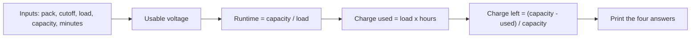

# Lesson P.2.5: Think in Comments — Plan the Job Before You Type Code

<!-- run-callout:start -->
> **Step 1 of 10 · Python and the maths a robot needs**
>
> **Run this in the workbench.** [Open MechaLab with `P.2.5` loaded](https://tle47.github.io/Mechatronics-Roadmap/?lesson=P.2.5) - it opens on the **Run Python Lessons** tab with that entry selected. Starter code, hints and the graded check are ready; this page is the reading copy, and nothing you type here is saved.
<!-- run-callout:end -->

## Goal
Plan a small robot battery report **in comments first**, then turn each comment into one line of arithmetic. The report answers four questions: how much voltage is usable, how long the pack should last, how much charge the test used, and what percentage is left.

- **New ideas (max 2):**
  1. **Comments are the plan:** Write the inputs, the output, the edge case and the expected check before typing code. A comment you cannot turn into one line is a question you have not answered yet.
  2. **First draft, then test the edges:** Write the simplest version for the normal numbers, run it, then try a load that is too high and a run that is longer than the pack can supply. A program is finished when you can say which cases you checked.
- **New syntax:** None. This lesson uses the variables and arithmetic from P.1 and P.2.
- **Target time (unmeasured — [log yours](../.github/ISSUE_TEMPLATE/beginner-timing-log.md)):** Typical: 1.0–1.5 hours | Slow-learner: 1.5–2.0 hours

### Requirements (what counts as complete)

Your finished program must satisfy **all** of these conditions:

- [ ] **Runs:** every TODO is completed and the script finishes without a Python error.
- [ ] **Types and given values:** keep the names, types, and units the starter gives; leave any value a TODO does not name unchanged.
- [ ] **Required end state:** `usable_mv` is 1300, `runtime_min` is about 314.3, `charge_used_mah` is 210.0 and `charge_left_percent` is about 90.5.
- [ ] **Output:** the four printed lines match the Expected Output block.
- [ ] **Alternate inputs:** the grader changes the pack, load and run-time values, so a hard-coded answer fails.

## Prerequisites

- [Lesson P.1: Variables and Fundamental Data Types](P.1-variables-and-data-types.md)
- [Lesson P.2: Computer Arithmetic and Order of Operations](P.2-arithmetic-and-order-of-operations.md)

## Learn

### Idea 1: Turning a problem into comments

- **Primary resource:** [Lesson P.6: Modules, Assert Statements & Reading a Traceback](P.6-modules-and-automated-asserts.md)
- **What to read:** the section that shows a passing self-check naming what must be true, and the traceback lines that name the failing line.
- **What to skip:** the import mechanics; this lesson only uses names you already have.
- **Key takeaway:** A comment that names the input, the output, the edge and the check is a plan you can turn into code one line at a time.

A beginner often opens the editor and starts typing because that feels like starting. Then the hard questions arrive halfway through: is the runtime based on the whole pack or only the usable part? Is “charge used” per hour or for this test? Should the answer be a voltage or a percentage? Each question forces a rewrite.

An engineer answers those questions **before** the code, in ordinary language:

```text
# Input: pack voltage, cutoff voltage, load current, capacity, run time.
# Output: usable voltage, estimated runtime, charge used, charge left.
# Edge: a load or run time that uses more than the pack holds.
# Check: the starter numbers should give 1300 mV, 314.3 min, 210 mAh and 90.5%.
```

Each line is a job you can finish:

- **Input and output** decide which names exist and what each answer means. `runtime_min` is a duration, not a voltage.
- **Edge** decides what you test after the normal case. A 30-minute run at 420 mA uses only 210 mAh of a 2200 mAh pack; a 10-hour run would use more than the pack has, so the report must not pretend otherwise.
- **Check** gives you a concrete expected answer. Without it, “it ran” is the only thing you can say — and “it ran” is not the same as “it is right”.

The rule of thumb: **one comment, one line of code.** If a comment needs three lines, it is really two or three steps; split it. If a line has no comment above it, ask whether you can explain why it exists.

### Idea 2: First draft, then make the edge fail

- **Primary resource:** [Lesson P.1: Variables and Fundamental Data Types](P.1-variables-and-data-types.md)
- **What to read:** how a name, a unit and a printed label are chosen before any arithmetic is written.
- **What to skip:** the data-type catalogue; this lesson only needs plain numbers.
- **Key takeaway:** A first draft is finished only when you have tried the normal case and the edge that would break it.

The first draft is allowed to be incomplete; it is not allowed to be vague. Write it in this order:

1. **Restate the problem in one sentence.** “Given a battery pack and a test load, report the usable voltage, runtime, charge used and charge left.”
2. **Name the pieces.** `pack_mv`, `cutoff_mv`, `load_ma`, `capacity_mah`, `run_minutes`.
3. **Write the steps as comments.** Subtract the cutoff. Divide capacity by load and convert hours to minutes. Multiply load by the run time. Subtract the charge used and divide by capacity.
4. **Turn each comment into code, top to bottom.** Run after each step, not after all of them.
5. **Try to break it.** A load of zero. A run time of zero. A run that uses the whole pack. A pack already at its cutoff.

Step 5 is where the learning happens. A program that passes the starter numbers is a hypothesis; the edge is the experiment. When an edge fails, you have found a question your plan did not answer — go back to the comments, answer it there, and only then change the code.



<!-- figure: signal-chain | The plan in one line: inputs, four calculations, one checked output. -->

### Bridge Notes

The same four comments work on every later P-track exercise. In P.3 the input is a raw command, the output is a clamped command, the edge is a value outside 0–255, and the check is the boundary case you can work out by hand. Writing those four lines first turns a page of instructions into a short list of jobs.

The battery report shows why the plan is written before the formulas. Each answer has a unit, and the unit decides the arithmetic: runtime is minutes, so hours from the charge-and-current pair must be scaled; charge used is mAh, so the run time must be in hours. A learner who starts typing formulas meets those choices halfway through the file, when the names are already fixed and a wrong unit looks like a wrong number. A learner who writes the four comments first meets them on paper, where a change costs one line.

The comments are also the debugging order: when the answer is wrong, you can ask which comment failed instead of rereading the whole program. A first draft in comments is cheap to change — moving a step or adding the edge is one line of prose, not a rewrite of working code. Keep the four lines at the top of the file as the record of what you checked.

## Do it yourself

### Starter Code (runs as-is — fill in the TODOs)

Save as `battery_report.py` and run `python3 battery_report.py`:

- **What is simulated and in which tool:** the arithmetic report, run in the workbench's Python tab with the checked call.
- **What is real-hardware only:** measuring a real pack's voltage and current with a multimeter.

```python
pack_mv = 11800
cutoff_mv = 10500
load_ma = 420
capacity_mah = 2200
run_minutes = 30

# TODO 1: Usable voltage is the pack voltage above the cutoff.
usable_mv = 0

# TODO 2: Estimate the runtime in minutes from the charge the pack holds and the current the load draws.
runtime_min = 0.0

# TODO 3: Charge used during that run, in mAh.
charge_used_mah = 0.0

# TODO 4: Charge left is the unused capacity as a percentage of the whole pack.
charge_left_percent = 0.0

print(f"Usable voltage: {usable_mv} mV")
print(f"Estimated runtime: {runtime_min:.1f} min")
print(f"Charge used: {charge_used_mah:.1f} mAh")
print(f"Charge left: {charge_left_percent:.1f}%")
```

### Expected Output
When all four TODOs are completed, running the script prints:

```text
Usable voltage: 1300 mV
Estimated runtime: 314.3 min
Charge used: 210.0 mAh
Charge left: 90.5%
```

### Hint Ladder

<details>
<summary><strong>Hint 1 (Concept nudge)</strong></summary>

Write the units beside each answer before writing the formula. Runtime is minutes, so `capacity_mah / load_ma` gives hours and must be multiplied by 60. Charge used is in mAh, so the run time must be in hours: `run_minutes / 60`.

</details>

<details>
<summary><strong>Hint 2 (Formula / structure)</strong></summary>

```python
usable_mv = pack_mv - cutoff_mv
runtime_min = (capacity_mah / load_ma) * 60
charge_used_mah = load_ma * (run_minutes / 60)
charge_left_percent = ((capacity_mah - charge_used_mah) / capacity_mah) * 100
```

</details>

<details>
<summary><strong>Full Solution</strong></summary>

```python
pack_mv = 11800
cutoff_mv = 10500
load_ma = 420
capacity_mah = 2200
run_minutes = 30

usable_mv = pack_mv - cutoff_mv
runtime_min = (capacity_mah / load_ma) * 60
charge_used_mah = load_ma * (run_minutes / 60)
charge_left_percent = ((capacity_mah - charge_used_mah) / capacity_mah) * 100

print(f"Usable voltage: {usable_mv} mV")
print(f"Estimated runtime: {runtime_min:.1f} min")
print(f"Charge used: {charge_used_mah:.1f} mAh")
print(f"Charge left: {charge_left_percent:.1f}%")
```

</details>

## Common mistakes & troubleshooting
- **Runtime in hours instead of minutes:** `capacity_mah / load_ma` gives hours. Multiply by 60 before printing minutes.
- **Charge used without converting minutes to hours:** `load_ma * run_minutes` is 100 times too large. Use `run_minutes / 60`.
- **Percentage as a fraction:** `(capacity - used) / capacity` gives 0.905, not 90.5. Multiply by 100 for a percentage.
- **Typing the expected answer:** The grader changes the inputs. Compute from the names, never from the output block.

## Check yourself

1. **Why is `runtime_min` based on `capacity_mah / load_ma` and not on the usable voltage?**
   <details>
   <summary><strong>Answer</strong></summary>

   Capacity is charge, measured in mAh; load is current, measured in mA. Dividing charge by current gives time. The usable voltage is a separate fact about the pack's safe range, not the amount of charge it holds.

   </details>

2. **A run uses 210 mAh of a 2200 mAh pack. What percentage is left, and why is that not 9.5%?**
   <details>
   <summary><strong>Answer</strong></summary>

   `(2200 - 210) / 2200 * 100 = 90.45%` left. The used fraction is 210 / 2200 = 9.5%, so the remainder is 100% − 9.5% = 90.5%.

   </details>

## Recap
- Write inputs, output, edge and check as comments before writing the formulas.
- Turn one comment into one line, run it, then test the normal case and the edge.
- A program is finished when you can name the cases you checked.

### You're ready to move on when...
- [ ] You can explain why each formula has the units it has.
- [ ] You can state the edge case this report does not handle yet.
- [ ] Your **Do it yourself** script prints the four expected lines.

<!-- next-step:start -->
👉 **Next:** [Step 1 · Python and the maths a robot needs — Lesson P.3: Conditional Decisions (if/elif/else) and Command Clamping](P.3-decisions-and-clamping.md)
<!-- next-step:end -->
