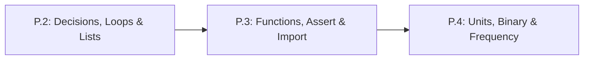

# Lesson P.3: Reusable Code & Self-Checks — Functions (`def`/`return`), `while` Loops, `assert` & `import`

## Goal
Package repeatable engineering calculations into functions (`def` and `return`), step simulations forward using `while` loops, load Python's `math` toolbox with `import`, and verify your own functions automatically with `assert`.

- **New ideas (max 2):**
  1. **Functions (`def`, parameters, `return`) and `while` loops**: Turning a formula into a reusable machine that accepts inputs and returns an output value, and repeating a step while a condition stays `True`.
  2. **Automated self-checks (`assert`) and standard libraries (`import`)**: Testing that your functions compute the right answers automatically and unlocking built-in math constants and functions via `import math`.
- **New syntax:** `def name(param1, param2):`, `return`, `while condition:`, `assert condition`, `abs()`, `import math`, `math.pi`, `math.sqrt()`. *(Note: Optional type hints `: float -> float`, floating-point tolerance `1e-9`, and `try/except` error handling are deferred to Track 00 Lesson `T1.00a` where they are first needed.)*
- **Estimated time (untimed guesses):** Typical: 2.0–3.0 hours | Slow-learner: 4.0–5.0 hours

---

## Prerequisites
- [Lesson P.1: Variables, Data Types & Arithmetic Expressions](P.1-variables-types-and-arithmetic.md)
- [Lesson P.2: Decisions (`if/else`), `for` Loops & Lists](P.2-decisions-loops-and-lists.md)



---

## Learn

### Idea 1: Functions (`def`, Parameters, `return`) and `while` Loops
- **Primary resource:** [futurecoder.io — Chapter 9: Functions](https://futurecoder.io/course/#toc) `[HTTP 200 — SPA/App: verify in-app]` *(Verified against [futurecoder GitHub source `c09_functions.py`](https://github.com/alexmojaki/futurecoder/blob/main/core/chapters/c09_functions.py) `[HTTP 200 — Verified by scripts/check_links.py]`)*
  - **What to read/complete:** Complete **`DefiningFunctions`**, **`CallingFunctionsWithinFunctions`**, **`ReturningValuesFromFunctions`**, and **`MoreOnReturn`** in **Chapter 9 (`Functions`)** `[verify in-app]`. Also read the **`While Loops`** section in [Harvard CS50P Lecture 2 Notes](https://cs50.harvard.edu/python/2022/notes/2/) `[HTTP 200 — Verified by scripts/check_links.py]`.
  - **What to skip:** Skip Chapters 8, 10, 11, and 12 in `futurecoder`.
  - **Key takeaway:** A **function** defined with `def` takes input variables called **parameters**, runs its indented body, and hands back an answer using `return` (unlike `print()`, which only shows text on screen and hands back `None`). Whereas a `for` loop runs a preset number of times, a **`while` loop** keeps repeating its indented block for as long as its condition remains `True`.
  - **Alternative resource:** [Harvard CS50P Lecture 0 Notes — `Def` and `Returning Values`](https://cs50.harvard.edu/python/2022/notes/0/) `[HTTP 200 — Verified by scripts/check_links.py]` — Read the final two sections **`Def`** and **`Returning Values`** at the bottom of the page.

### Idea 2: Automated Self-Checks (`assert`) and Standard Libraries (`import`)
- **Primary resource:** [futurecoder.io — Chapter 9: `TestingFunctions` (`assert`)](https://futurecoder.io/course/#toc) `[HTTP 200 — SPA/App: verify in-app]` & [Harvard CS50P Lecture 4 Notes — `Libraries`](https://cs50.harvard.edu/python/2022/notes/4/) `[HTTP 200 — Verified by scripts/check_links.py]`
  - **What to read/complete:** Complete **`TestingFunctions`** in `futurecoder` Chapter 9 `[verify in-app]`, and read the opening **`Libraries`** introduction in [CS50P Lecture 4 Notes](https://cs50.harvard.edu/python/2022/notes/4/) `[HTTP 200 — Verified by scripts/check_links.py]`.
  - **What to skip:** In CS50P Lecture 4 Notes, skip **`Random`**, **`Statistics`**, **`Command-Line Arguments`**, **`slice`**, **`Packages`**, and **`APIs`**.
  - **Key takeaway:** An **`assert`** statement checks that a condition is `True`; if a bug makes the condition `False`, Python immediately halts with an `AssertionError` so bad math never goes unnoticed. Writing `import math` at the top of a script loads Python's built-in **module** (library toolbox) of mathematical constants like `math.pi` ($\pi \approx 3.14159$) and functions like `math.sqrt(x)` ($\sqrt{x}$).
  - **Alternative resource:** [Official Python 3 Tutorial — Section 4.8: Defining Functions](https://docs.python.org/3/tutorial/controlflow.html) `[HTTP 200 — Verified by scripts/check_links.py]` — Read exact heading **`4.8. Defining Functions`** (skip `4.8.1` onward).

### Bridge Notes
Instead of copying and pasting the same voltage or distance formula ten times, engineers wrap it inside a **function** using `def`. The variables listed inside the parentheses of `def clamp(val, low, high):` are **parameters** (placeholders for the inputs you pass in when calling `clamp(300, 0, 255)`). Inside the function, **`return`** sends the computed number back to the caller and immediately exits the function. Never replace `return` with `print()` inside a calculation function: `print()` only displays text for humans and returns `None` (empty value), which crashes any math that tries to use the result!

When you don't know in advance how many steps a robot will take to reach a target, use a **`while` loop** (`while pos_m < target_m:`), making sure the loop body updates `pos_m` each tick so it eventually finishes. To use square roots or $\pi$, put `import math` at the top of your file to load the **`math` module** (`math.sqrt(25)` returns `5.0`, and `abs(-3.5)` returns the positive magnitude `3.5`). Finally, place **`assert`** checks right after your functions (such as `assert clamp(300, 0, 255) == 255`) so your script proves its own math works every time it runs.

---

## Do it yourself

- **What is simulated and in which tool:** Runs 100% in Python (in [futurecoder.io](https://futurecoder.io/course/) `[verify in-app]` or locally via `python3`).
- **What is real-hardware only:** Nothing in this lesson requires hardware.

### Starter Code (runs as-is — fill in the TODOs)
Complete `clamp_pwm`, `distance_2d`, and the `while` loop (`TODO 1`, `TODO 2`, `TODO 3`), then uncomment the `assert` lines at the bottom to verify your code:

```python
import math


def clamp_pwm(pwm_val, min_val, max_val):
    # TODO 1: Return min_val if pwm_val < min_val,
    #         return max_val if pwm_val > max_val,
    #         otherwise return pwm_val.
    return 0


def distance_2d(dx_m, dy_m):
    # TODO 2: Return the straight-line distance sqrt(dx_m**2 + dy_m**2)
    #         using math.sqrt(...)
    return 0.0


# Simulate a robot moving toward target_m = 1.0 m at 0.25 m per step
pos_m = 0.0
step_m = 0.25
steps_taken = 0

# TODO 3: Write a while loop that runs while pos_m < 1.0:
#         Inside the loop, add step_m to pos_m and add 1 to steps_taken.

print(f"Clamp test: {clamp_pwm(300, 0, 255)} | {clamp_pwm(-20, 0, 255)} | {clamp_pwm(120, 0, 255)}")
print(f"3-4-5 triangle distance: {distance_2d(3.0, 4.0):.1f} m")
print(f"Reached {pos_m:.2f} m in {steps_taken} steps")
```

### Expected Output
When `TODO 1`, `TODO 2`, and `TODO 3` are completed, running the script prints:

```text
Clamp test: 255 | 0 | 120
3-4-5 triangle distance: 5.0 m
Reached 1.00 m in 4 steps
```

### Hint Ladder

<details>
<summary><strong>Hint 1 (Concept nudge)</strong></summary>

In `clamp_pwm`, use an `if / elif / else` block where each branch uses `return` (not `print`). In `distance_2d`, pass `(dx_m ** 2) + (dy_m ** 2)` inside `math.sqrt(...)`. For `TODO 3`, start with `while pos_m < 1.0:` and indent both update lines by 4 spaces.
</details>

<details>
<summary><strong>Hint 2 (Formula / structure)</strong></summary>

Check your `distance_2d` and `while` loop structure:
```python
def distance_2d(dx_m, dy_m):
    return math.sqrt((dx_m ** 2) + (dy_m ** 2))

while pos_m < 1.0:
    pos_m = pos_m + step_m
    steps_taken = steps_taken + 1
```
</details>

<details>
<summary><strong>Full Solution</strong></summary>

```python
import math


def clamp_pwm(pwm_val, min_val, max_val):
    if pwm_val < min_val:
        return min_val
    elif pwm_val > max_val:
        return max_val
    else:
        return pwm_val


def distance_2d(dx_m, dy_m):
    return math.sqrt((dx_m ** 2) + (dy_m ** 2))


pos_m = 0.0
step_m = 0.25
steps_taken = 0

while pos_m < 1.0:
    pos_m = pos_m + step_m
    steps_taken = steps_taken + 1

assert clamp_pwm(300, 0, 255) == 255
assert clamp_pwm(-20, 0, 255) == 0
assert clamp_pwm(120, 0, 255) == 120
assert distance_2d(3.0, 4.0) == 5.0
assert steps_taken == 4

print(f"Clamp test: {clamp_pwm(300, 0, 255)} | {clamp_pwm(-20, 0, 255)} | {clamp_pwm(120, 0, 255)}")
print(f"3-4-5 triangle distance: {distance_2d(3.0, 4.0):.1f} m")
print(f"Reached {pos_m:.2f} m in {steps_taken} steps")
```
</details>

---

## Common mistakes & troubleshooting
- **`TypeError: unsupported operand type(s) for +: 'NoneType' and 'int'`:** Your function used `print(answer)` instead of `return answer`. Because a function without `return` outputs `None`, trying to do math with its output fails.
- **`NameError: name 'math' is not defined`:** You called `math.sqrt(...)` or `math.pi` without putting `import math` at the top of your script.
- **Infinite `while` loop (program hangs forever):** If you write `while pos_m < 1.0:` and forget to increase `pos_m` inside the indented block, `pos_m` stays `0.0` forever. Stop the program (`Ctrl+C` or Stop button) and indent `pos_m = pos_m + step_m` inside the loop.
- **`AssertionError`:** An `assert` line evaluated to `False`. Check the line number in the error traceback to see which function input failed its test.

---

## Check yourself

1. **`return` vs. `print()`:** What happens if you define `def double(x): print(x * 2)` (with no `return`) and then run `y = double(5) + 1`?
   <details>
   <summary><strong>Answer</strong></summary>

   Python prints `10` on the screen, but `double(5)` hands back **`None`** to the expression `y = None + 1`, which crashes with a **`TypeError`** because you cannot add `1` to `None`. Changing `print(x * 2)` to `return x * 2` makes `y` equal **`11`**.
   </details>

2. **Tracing a `while` loop:** How many times does the body of this loop run, and what is the final value of `voltage`?
   ```python
   voltage = 12.0
   while voltage > 10.5:
       voltage = voltage - 0.5
   ```
   <details>
   <summary><strong>Answer</strong></summary>

   It runs **3 times** (`12.0 -> 11.5 -> 11.0 -> 10.5`), and the final value of `voltage` is **`10.5`** (since `10.5 > 10.5` is `False`, the loop stops).
   </details>

3. **Using `math.sqrt` and `abs`:** What number does `math.sqrt(abs(-16.0)) + 2.0` evaluate to?
   <details>
   <summary><strong>Answer</strong></summary>

   **`6.0`**. First `abs(-16.0)` gives `16.0`, then `math.sqrt(16.0)` gives `4.0`, and `4.0 + 2.0` equals **`6.0`**.
   </details>

---

## Recap
- **`def` and `return`** package formulas into reusable functions that take parameters and return computed outputs.
- **`while` loops** repeat an indented block as long as a condition stays `True`.
- **`import math`** provides `math.pi` and `math.sqrt()`, while **`assert`** automatically verifies that your functions return the right numbers.

### You're ready to move on when...
- [ ] You can explain why calculation functions must use `return` rather than `print()`.
- [ ] Your `clamp_pwm`, `distance_2d`, and `while` loop pass all 5 `assert` checks in **Do it yourself**.
- **Next lesson:** [Lesson P.4: SI Units, Metric Prefixes, Binary Bits & Frequency (`Hz`)](P.4-units-prefixes-binary-and-frequency.md)
