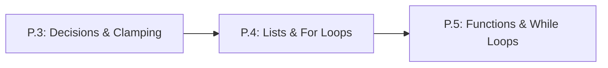

# Lesson P.4: Ordered Lists and Repeating Actions with `for` Loops

<!-- run-callout:start -->
> **Step 1 of 10 · Python and the maths a robot needs**
>
> **Run this in the workbench.** [Open MechaLab with `P.4` loaded](https://tle47.github.io/Mechatronics-Roadmap/?lesson=P.4) - it opens on the **Run Python Lessons** tab with that entry selected. Starter code, hints and the graded check are ready; this page is the reading copy, and nothing you type here is saved.
<!-- run-callout:end -->

## Goal
Store sequences of sensor readings in zero-indexed Python `lists` (`[a, b, c]`) and process every item automatically using `for` loops and `range()`.

- **New ideas (max 2):**
  1. **Ordered lists with zero-based indexing**: Grouping multiple values in square brackets `[...]` where position counting starts at index `0`.
  2. **Repeating actions with `for` loops**: Stepping through every element of a list (`for item in my_list:`) or a fixed number of ticks (`for step in range(n):`).
- **New syntax:** `[a, b, c]`, `items[0]`, `items.append(x)`, `len(items)`, `for x in items:`, `range(n)`.
- **Target time (unmeasured — [log yours](../.github/ISSUE_TEMPLATE/beginner-timing-log.md)):** Typical: 1.5–2.0 hours | Slow-learner: 2.5–3.5 hours

---

## Prerequisites
- [Lesson P.3: Conditional Decisions (`if/elif/else`) & Command Clamping](P.3-decisions-and-clamping.md)



---

## Learn

<!-- figure: for-loop | One item per pass, and the body never decides when the loop ends. -->


### Idea 1: Ordered lists with zero-based indexing
- **Primary resource:** [Official Python 3 Tutorial — Section 3.1.3: Lists](https://docs.python.org/3/tutorial/introduction.html) `[HTTP 200 — Verified by scripts/check_links.py]`
  - **What to read:** Read exact heading **`3.1.3. Lists`** (creating lists with square brackets, indexing with `[0]`, `.append()`, and `len()`).
  - **What to skip:** Skip nested lists at the very end of the section.
  - **Key takeaway:** A **list** stores an ordered sequence of values inside square brackets, such as `distances = [12.1, 11.9, 11.8]`. Python uses **zero-based indexing**: the first item is at index `0` (`distances[0]` is `12.1`), the second is at index `1`, and the last item in a list of length `len(distances)` (`3`) is at index `2`.
  - **Alternative resource:** [futurecoder.io — Chapter 6 (`Lists`)](https://futurecoder.io/course/#toc) `[verify in-app]` — Complete **Chapter 6 (`Lists`)** `[verify in-app]`.

### Idea 2: Repeating actions with `for` loops
- **Primary resource:** [Harvard CS50P Lecture 2 Notes](https://cs50.harvard.edu/python/2022/notes/2/) `[HTTP 200 — Verified by scripts/check_links.py]`
  - **What to read:** Read exact headings **`For Loops`**, **`More About Lists`**, and **`Length`**.
  - **What to skip:** Skip **`While Loops`** (covered in Lesson P.5), **`Dictionaries`**, and **`Mario`**.
  - **Key takeaway:** Instead of copy-pasting the same calculation ten times, a **`for` loop** (`for x in items:`) visits each element of a list one by one and runs its indented block. When you want to run a loop a specific number of times $N$, `for step in range(N):` counts `step` through `0, 1, 2, ..., N - 1`.
  - **Alternative resource:** [futurecoder.io — Chapter 4 (`For Loops`)](https://futurecoder.io/course/#toc) `[verify in-app]` — Complete **Chapter 4 (`For Loops`)** `[verify in-app]`.

### Bridge Notes
Sensors on a robot produce streams of measurements over time. Instead of inventing separate variable names like `s0`, `s1`, `s2`, `s3`, we store a sequence inside a **list**: `samples = [12.2, 12.0, 11.8, 11.6]`. Because computers count offsets from the beginning of memory, **zero-based indexing** means:
- `samples[0]` is the 1st item (`12.2`),
- `samples[3]` is the 4th (last) item (`11.6`),
- `len(samples)` returns the count of items (`4`), and `samples.append(11.5)` adds a new item to the end.

**Repeating actions with `for` loops** (`for x in samples:`) lets you filter, clamp, or average thousands of sensor readings in four lines of code without copy-pasting. To accumulate a running sum (for example, to compute the average of a list of sensor readings), create an accumulator variable `total = 0.0` *before* the `for` loop, add each item inside the indented loop (`total = total + x`), and divide `total / len(samples)` after the loop finishes.

---

## Do it yourself

- **What is simulated and in which tool:** Runs 100% in Python (zero-install in [futurecoder.io](https://futurecoder.io/course/) `[verify in-app]` or locally via `python3`).
- **What is real-hardware only:** Nothing in this lesson requires hardware.

### Starter Code (runs as-is — fill in the TODOs)
Complete `TODO 1` and `TODO 2` to loop through `raw_commands`, clamp each value into `[0, 255]`, append it to `clamped_commands`, and compute `total_cmd`:

```python
raw_commands = [-30, 0, 64, 128, 200, 310]
clamped_commands = []
total_cmd = 0

for cmd in raw_commands:
    # TODO 1: Clamp cmd into [0, 255] using if / elif / else,
    #         storing the result in safe_cmd.
    safe_cmd = cmd

    # TODO 2: Append safe_cmd to clamped_commands using clamped_commands.append(safe_cmd)
    #         and add safe_cmd to total_cmd.

mean_cmd = total_cmd / len(raw_commands)
print(f"Clamped list: {clamped_commands}")
print(f"First={raw_commands[0]} | Last={raw_commands[5]} | Mean Clamped Cmd={mean_cmd:.2f}")
```

### Expected Output
When `TODO 1` and `TODO 2` are completed, running the script prints:

```text
Clamped list: [0, 0, 64, 128, 200, 255]
First=-30 | Last=310 | Mean Clamped Cmd=107.83
```

### Hint Ladder

<details>
<summary><strong>Hint 1 (Concept nudge)</strong></summary>

Inside the `for cmd in raw_commands:` loop, use the exact same `if cmd > 255:` / `elif cmd < 0:` clamping logic from Lesson P.3, then call `clamped_commands.append(safe_cmd)` and `total_cmd = total_cmd + safe_cmd`.
</details>

<details>
<summary><strong>Hint 2 (Formula / structure)</strong></summary>

```python
for cmd in raw_commands:
    if cmd > 255:
        safe_cmd = 255
    elif cmd < 0:
        safe_cmd = 0
    else:
        safe_cmd = cmd
    clamped_commands.append(safe_cmd)
    total_cmd = total_cmd + safe_cmd
```
</details>

<details>
<summary><strong>Full Solution</strong></summary>

```python
raw_commands = [-30, 0, 64, 128, 200, 310]
clamped_commands = []
total_cmd = 0

for cmd in raw_commands:
    if cmd > 255:
        safe_cmd = 255
    elif cmd < 0:
        safe_cmd = 0
    else:
        safe_cmd = cmd
    clamped_commands.append(safe_cmd)
    total_cmd = total_cmd + safe_cmd

mean_cmd = total_cmd / len(raw_commands)
print(f"Clamped list: {clamped_commands}")
print(f"First={raw_commands[0]} | Last={raw_commands[5]} | Mean Clamped Cmd={mean_cmd:.2f}")
```
</details>

---

## Common mistakes & troubleshooting
- **`IndexError: list index out of range`:** In a 4-item list, valid indices are `0, 1, 2, 3`. Asking for index `4` crashes because index counting starts at `0`.
- **Resetting `total_cmd = 0` inside the `for` loop:** If you put `total_cmd = 0` inside the indented loop body, it erases the sum on every iteration! Always initialize accumulators *above* the `for` line.
- **Expecting `range(5)` to include `5`:** `range(5)` generates `0, 1, 2, 3, 4` (5 numbers total, stopping *before* `5`).

---

## Check yourself

1. **Zero-based indexing:** Given `temps = [25.0, 31.2, 42.8, 38.5]`, what is `temps[0]`, what is `temps[3]`, and what happens if you evaluate `temps[4]`?
   <details>
   <summary><strong>Answer</strong></summary>

   `temps[0]` is **`25.0`**, `temps[3]` is **`38.5`**, and `temps[4]` raises an **`IndexError: list index out of range`**.
   </details>

2. **Counting `range(n)` iterations:** What numbers does `for k in range(4): print(k)` print?
   <details>
   <summary><strong>Answer</strong></summary>

   **`0`, `1`, `2`, `3`** (four numbers starting at `0`).
   </details>

3. **Tracing a loop sum:** What is the value of `s` after running `s = 0` followed by `for x in [2, 4, 6]: s = s + x`?
   <details>
   <summary><strong>Answer</strong></summary>

   **`12`** (`0 + 2 = 2`, `2 + 4 = 6`, `6 + 6 = 12`).
   </details>

---

## Recap
- A **list** (`[a, b, c]`) stores an ordered sequence where index `0` is the first element and `len(items)` is the total count.
- A **`for` loop** repeats an indented block once for every element in a list or `range(n)`.

### You're ready to move on when...
- [ ] You can read the first and last element of any list using zero-based indices.
- [ ] You can use a `for` loop to clamp or sum a list of sensor values.
- [ ] Your **Do it yourself** script prints `Clamped list: [0, 0, 64, 128, 200, 255]` and `Mean Clamped Cmd=107.83`.

<!-- next-step:start -->
👉 **Next:** [Step 1 · Python and the maths a robot needs — Lesson P.5: Reusable Functions (def/return) and while Loops](P.5-functions-and-while-loops.md)
<!-- next-step:end -->
