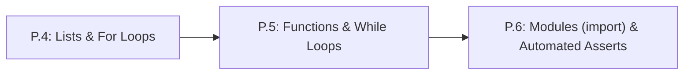

# Lesson P.5: Reusable Functions (`def`/`return`) and `while` Loops

<!-- run-callout:start -->
> **Run this in the workbench.** [Open MechaLab on `P.5`](https://tle47.github.io/Mechatronics-Roadmap/?lesson=P.5) - Tab 2 opens with that entry selected, starter code, hints and graded check ready. This page is the reading copy, and nothing you type here is saved.
<!-- run-callout:end -->

## Goal
Package repeatable engineering calculations into named functions using `def` and `return`, and step physical simulations forward in time using `while` loops.

- **New ideas (max 2):**
  1. **Reusable functions (`def` and `return`)**: Defining a named block of code that accepts input parameters, performs a calculation, and hands the numerical answer back via `return`.
  2. **Condition-controlled `while` loops**: Repeating an indented simulation step for as long as a condition (`step < total_steps`) remains `True`.
- **New syntax:** `def func_name(param1, param2):`, `return value`, `while condition:`.
- **Target time (unmeasured — [log yours](../.github/ISSUE_TEMPLATE/beginner-timing-log.md)):** Typical: 1.5–2.0 hours | Slow-learner: 2.5–3.5 hours

---

## Prerequisites
- [Lesson P.3: Conditional Decisions (`if/elif/else`) & Command Clamping](P.3-decisions-and-clamping.md)
- [Lesson P.4: Ordered Lists & Repeating Actions with `for` Loops](P.4-lists-and-for-loops.md)



---

## Learn

### Idea 1: Reusable functions (`def` and `return`)
- **Primary resource:** [futurecoder.io — Chapter 10 (`Functions`)](https://futurecoder.io/course/#toc) `[verify in-app]`
  - **What to complete:** Complete the pages on defining functions, parameters, and returning values in **Chapter 10 (`Functions`)** `[verify in-app]`.
  - **What to skip:** Skip Chapters 8, 9, 11, and 12.
  - **Key takeaway:** A **function** (`def clamp_cmd(cmd):`) is a reusable machine: you feed input numbers into its **parameters** inside the parentheses, and the `return` keyword hands the computed answer back to the caller so later code can store it in a variable. Never confuse `return` with `print()`: `print()` only displays text on screen and hands back `None`!
  - **Alternative resource:** [Harvard CS50P Lecture 0 Notes](https://cs50.harvard.edu/python/2022/notes/0/) `[HTTP 200 — Verified by scripts/check_links.py]` — Read exact heading **`Def`**.

### Idea 2: Condition-controlled `while` loops
- **Primary resource:** [Harvard CS50P Lecture 2 Notes](https://cs50.harvard.edu/python/2022/notes/2/) `[HTTP 200 — Verified by scripts/check_links.py]`
  - **What to read:** Read exact heading **`While Loops`**.
  - **What to skip:** Skip **`Dictionaries`** and **`Mario`**.
  - **Key takeaway:** A **`while` loop** (`while step < 5:`) checks its condition before every pass and repeats its indented body as long as the condition is `True`. You must always update the loop counter (`step = step + 1`) inside the `while` block so the loop eventually stops!

### Bridge Notes
In Lesson P.3, you wrote an `if / elif / else` block to clamp an actuator command into `[0, 255]`. What if you need to clamp 20 different commands across your robot program? Instead of copy-pasting the same 6 lines 20 times, you wrap them once inside a **function**:

```python
def clamp_cmd(cmd):
    if cmd > 255:
        return 255
    elif cmd < 0:
        return 0
    return cmd
```

Here, `cmd` is the input **parameter**, and `return` sends the clamped number back to wherever `clamp_cmd(...)` was called. If a function uses `print(cmd)` instead of `return cmd`, Python returns the empty value `None`, and any math that tries to use the result will crash with a `TypeError`.

Functions pair naturally with **`while` loops** when simulating motion or control loops over time: as long as `step < num_steps` (or `pos_m < target_m`), the `while` loop calls your step function to advance position and increments `step = step + 1`.

---

## Do it yourself

- **What is simulated and in which tool:** Runs 100% in Python (zero-install in [futurecoder.io](https://futurecoder.io/course/) `[verify in-app]` or locally via `python3`).
- **What is real-hardware only:** Nothing in this lesson requires hardware.

### Starter Code (runs as-is — fill in the TODOs)
Complete `step_position` (`TODO 1`) and the `while` loop (`TODO 2`) to step a robot forward 4 times with velocity `1.5 m/s` and time step `dt_s = 0.2 s`:

```python
def step_position(pos_m, vel_m_s, dt_s):
    # TODO 1: Return the updated position: pos_m + (vel_m_s * dt_s)
    return pos_m


pos_m = 0.0
vel_m_s = 1.5
dt_s = 0.2
step = 0

# TODO 2: Inside the while loop, update pos_m by calling step_position(pos_m, vel_m_s, dt_s),
#         and increment step by 1 so the loop runs exactly 4 times.
while step < 4:
    pos_m = step_position(pos_m, vel_m_s, dt_s)
    step = 4

print(f"After {step} steps: pos_m = {pos_m:.2f} m")
```

### Expected Output
When `TODO 1` and `TODO 2` are completed, running the script prints:

```text
After 4 steps: pos_m = 1.20 m
```

### Hint Ladder

<details>
<summary><strong>Hint 1 (Concept nudge)</strong></summary>

In `TODO 1`, use `return pos_m + (vel_m_s * dt_s)`. In `TODO 2`, replace `step = 4` with `step = step + 1` so the `while step < 4:` loop counts `0 -> 1 -> 2 -> 3 -> 4`.
</details>

<details>
<summary><strong>Hint 2 (Formula / structure)</strong></summary>

```python
def step_position(pos_m, vel_m_s, dt_s):
    return pos_m + (vel_m_s * dt_s)

while step < 4:
    pos_m = step_position(pos_m, vel_m_s, dt_s)
    step = step + 1
```
</details>

<details>
<summary><strong>Full Solution</strong></summary>

```python
def step_position(pos_m, vel_m_s, dt_s):
    return pos_m + (vel_m_s * dt_s)


pos_m = 0.0
vel_m_s = 1.5
dt_s = 0.2
step = 0

while step < 4:
    pos_m = step_position(pos_m, vel_m_s, dt_s)
    step = step + 1

print(f"After {step} steps: pos_m = {pos_m:.2f} m")
```
</details>

---

## Common mistakes & troubleshooting
- **Using `print()` instead of `return` inside a function:** If `step_position` ends with `print(pos_m + vel_m_s * dt_s)` and has no `return`, calling `pos_m = step_position(...)` sets `pos_m` to `None` and crashes on the next step with `TypeError: unsupported operand type(s) for +: 'NoneType' and 'float'`.
- **Infinite `while` loop:** Forgetting `step = step + 1` inside `while step < 4:` leaves `step` at `0` forever so the program never finishes.

---

## Check yourself

1. **`return` vs. `print()`:** What happens if you run `def double(x): print(x * 2)` and then `y = double(5) + 1`?
   <details>
   <summary><strong>Answer</strong></summary>

   It crashes with a **`TypeError`** (`unsupported operand type(s) for +: 'NoneType' and 'int'`) because `double(5)` printed `10` to the screen but returned `None`. Replacing `print(x * 2)` with `return x * 2` makes `y` equal `11`.
   </details>

2. **Writing a function:** Write a 2-line function `travel_distance(speed_m_s, time_s)` that returns distance $d = v \cdot t$.
   <details>
   <summary><strong>Answer</strong></summary>

   ```python
   def travel_distance(speed_m_s, time_s):
       return speed_m_s * time_s
   ```
   </details>

3. **Tracing a `while` loop:** How many times does the body of `k = 0; while k < 3: k = k + 1` execute, and what is `k` when the loop finishes?
   <details>
   <summary><strong>Answer</strong></summary>

   It executes **3 times** (when `k` is `0`, `1`, and `2`), and when the loop finishes, `k` equals **`3`**.
   </details>

---

## Recap
- A **function** (`def`) takes input parameters and uses **`return`** to hand back a computed value.
- A **`while` loop** repeats its indented block as long as its condition remains `True`.

### You're ready to move on when...
- [ ] You can explain why calculations inside a function must use `return` rather than `print()`.
- [ ] You can trace a `while` loop and verify that its counter updates on every pass.
- [ ] Your **Do it yourself** script prints `After 4 steps: pos_m = 1.20 m`.
- **Next lesson:** [Lesson P.6: Loading Modules (`import`) & Automated Self-Checks (`assert`)](P.6-modules-and-automated-asserts.md)
