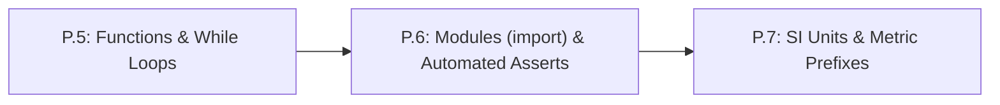

# Lesson P.6: Loading Modules (`import`) and Automated Self-Checks (`assert`)

## Goal
Load built-in math tools (`math.sqrt`, `math.pi`) using `import math`, and write automated self-checks (`assert`) so your code verifies its own calculations automatically.

- **New ideas (max 2):**
  1. **Loading standard-library modules with `import`**: Using `import math` at the top of a script to unlock square roots (`math.sqrt`), $\pi$ (`math.pi`), and trigonometry.
  2. **Automated self-checks with `assert`**: Writing `assert condition` so Python immediately flags an `AssertionError` if a function returns the wrong number.
- **New syntax:** `import math`, `math.sqrt(x)`, `round(val, digits)`, `assert condition`.
- **Target time (unmeasured — [log yours](../.github/ISSUE_TEMPLATE/beginner-timing-log.md)):** Typical: 1.0–1.5 hours | Slow-learner: 2.0–3.0 hours

---

## Prerequisites
- [Lesson P.5: Reusable Functions (`def`/`return`) & `while` Loops](P.5-functions-and-while-loops.md)



---

## Learn

### Idea 1: Loading standard-library modules with `import`
- **Primary resource:** [Harvard CS50P Lecture 4 Notes](https://cs50.harvard.edu/python/2022/notes/4/) `[HTTP 200 — Verified by scripts/check_links.py]`
  - **What to read:** Read exact headings **`Libraries`** and **`Random`** (see how `import` loads a module at the top of a file and calls functions using dot notation `module.func()`).
  - **What to skip:** Skip **`Command-Line Arguments`**, **`slice`**, **`Packages`**, and **`APIs`**.
  - **Key takeaway:** Python keeps specialized tools organized inside built-in **modules** (libraries). Writing `import math` at the top of your script loads the `math` module so you can call `math.sqrt(25.0)` ($\sqrt{25} = 5.0$) or use the constant `math.pi` ($\pi \approx 3.14159265$).

### Idea 2: Automated self-checks with `assert`
- **Primary resource:** [Harvard CS50P Lecture 5 Notes](https://cs50.harvard.edu/python/2022/notes/5/) `[HTTP 200 — Verified by scripts/check_links.py]`
  - **What to read:** Read exact headings **`Unit Tests`** and **`assert`**.
  - **What to skip:** Skip **`pytest`**, **`Testing Strings`**, and **`Organizing Tests into Folders`**.
  - **Key takeaway:** Instead of checking printed numbers by eye every time you edit a script, `assert condition` tests your code automatically: if `condition` is `True`, Python continues silently; if `False`, Python stops immediately on that line with an `AssertionError`.

### Bridge Notes
When calculating the straight-line distance from a robot's shoulder joint at $(0, 0)$ to a target at $(x, y)$, we use the Pythagorean theorem $d = \sqrt{x^2 + y^2}$. Instead of raising to the $0.5$ power, we load Python's built-in **`math` module** at the top of our file with `import math` and call `math.sqrt((x ** 2) + (y ** 2))`.

How do professional robotics engineers make sure a bug never slips into a formula? They write **unit tests** right below their functions using **`assert`**. For example, we know a $3\text{–}4\text{–}5$ right triangle ($x = 3.0\text{ m}, y = 4.0\text{ m}$) has hypotenuse $\sqrt{3^2 + 4^2} = \sqrt{25} = 5.0\text{ m}$. Writing:

```python
assert distance_2d(3.0, 4.0) == 5.0
```

runs an automatic safety check every time the script starts. When comparing decimal `float` results that might have tiny rounding tails (like `0.30000000000000004`), wrap the value in `round(value, 4)` inside your assertion (`assert round(val, 4) == 0.3`) so the check compares to 4 decimal places.

---

## Do it yourself

- **What is simulated and in which tool:** Runs 100% in Python (zero-install in [futurecoder.io](https://futurecoder.io/course/) `[verify in-app]` or locally via `python3`).
- **What is real-hardware only:** Nothing in this lesson requires hardware.

### Starter Code (runs as-is — fill in the TODOs)
Complete `distance_2d` (`TODO 1`) using `math.sqrt` and `clamp_cmd` (`TODO 2`), then uncomment or keep the `assert` self-checks in `TODO 3`:

```python
import math


def distance_2d(x_m, y_m):
    # TODO 1: Return math.sqrt((x_m ** 2) + (y_m ** 2))
    return 5.0


def clamp_cmd(cmd):
    # TODO 2: Clamp cmd into [0, 255] and return the clamped integer
    return 255


d1 = distance_2d(3.0, 4.0)
d2 = distance_2d(0.6, 0.8)

# TODO 3: Verify that all assertions pass once TODO 1 and TODO 2 are implemented!
assert round(d1, 4) == 5.0
assert clamp_cmd(300) == 255

print(f"Distance (3, 4): {d1:.2f} m | Distance (0.6, 0.8): {d2:.2f} m")
print(f"Clamped(-20)={clamp_cmd(-20)} | Clamped(128)={clamp_cmd(128)} | Clamped(300)={clamp_cmd(300)}")
print("All assert checks passed!")
```

### Expected Output
When `TODO 1` and `TODO 2` are completed, running the script prints:

```text
Distance (3, 4): 5.00 m | Distance (0.6, 0.8): 1.00 m
Clamped(-20)=0 | Clamped(128)=128 | Clamped(300)=255
All assert checks passed!
```

### Hint Ladder

<details>
<summary><strong>Hint 1 (Concept nudge)</strong></summary>

In `distance_2d`, pass `(x_m ** 2) + (y_m ** 2)` inside `math.sqrt(...)`. In `clamp_cmd`, use `if cmd > 255: return 255` and `elif cmd < 0: return 0`, followed by `return cmd`.
</details>

<details>
<summary><strong>Hint 2 (Formula / structure)</strong></summary>

```python
def distance_2d(x_m, y_m):
    return math.sqrt((x_m ** 2) + (y_m ** 2))

def clamp_cmd(cmd):
    if cmd > 255:
        return 255
    elif cmd < 0:
        return 0
    return cmd
```
</details>

<details>
<summary><strong>Full Solution</strong></summary>

```python
import math


def distance_2d(x_m, y_m):
    return math.sqrt((x_m ** 2) + (y_m ** 2))


def clamp_cmd(cmd):
    if cmd > 255:
        return 255
    elif cmd < 0:
        return 0
    return cmd


d1 = distance_2d(3.0, 4.0)
d2 = distance_2d(0.6, 0.8)

assert round(d1, 4) == 5.0
assert round(d2, 4) == 1.0
assert clamp_cmd(-20) == 0
assert clamp_cmd(128) == 128
assert clamp_cmd(300) == 255

print(f"Distance (3, 4): {d1:.2f} m | Distance (0.6, 0.8): {d2:.2f} m")
print(f"Clamped(-20)={clamp_cmd(-20)} | Clamped(128)={clamp_cmd(128)} | Clamped(300)={clamp_cmd(300)}")
print("All assert checks passed!")
```
</details>

---

## Common mistakes & troubleshooting
- **`NameError: name 'math' is not defined`:** You called `math.sqrt(...)` without putting `import math` at the top of the file.
- **`NameError: name 'sqrt' is not defined`:** After `import math`, you must write `math.sqrt(x)` with the `math.` prefix, not bare `sqrt(x)`.
- **`AssertionError` with no message:** Look at the line number printed in the traceback—the expression after `assert` on that line evaluated to `False`. Print the actual return value of your function right above the `assert` line to see what it computed.

---

## Check yourself

1. **What `assert` does when `True` vs. `False`:** What happens when Python executes `assert 2 + 2 == 4`, and what happens when it executes `assert 2 + 2 == 5`?
   <details>
   <summary><strong>Answer</strong></summary>

   `assert 2 + 2 == 4` succeeds silently and moves to the next line. `assert 2 + 2 == 5` immediately stops the program and raises an **`AssertionError`**.
   </details>

2. **Using `math.sqrt`:** What value does `math.sqrt((6.0 ** 2) + (8.0 ** 2))` return?
   <details>
   <summary><strong>Answer</strong></summary>

   **`10.0`** ($\sqrt{36 + 64} = \sqrt{100} = 10.0$).
   </details>

3. **Why round floats in `assert`?** Why is `assert round(0.1 + 0.2, 4) == 0.3` safer than `assert 0.1 + 0.2 == 0.3`?
   <details>
   <summary><strong>Answer</strong></summary>

   Because computer floating-point numbers store `0.1 + 0.2` as `0.30000000000000004`, so exact `== 0.3` fails! Rounding with `round(..., 4)` compares to 4 decimal places (`0.3 == 0.3`).
   </details>

---

## Recap
- `import math` loads Python's standard math library (`math.sqrt`, `math.pi`).
- `assert condition` automatically verifies that functions return the expected results.

### You're ready to move on when...
- [ ] You can import `math` and call `math.sqrt()`.
- [ ] You can write `assert` checks to test a function at normal and boundary inputs.
- [ ] Your **Do it yourself** script passes all assertions and prints `All assert checks passed!`.
- **Next lesson:** [Lesson P.7: Base SI Units & Metric Prefixes (`M`, `k`, `m`, `µ`)](P.7-si-units-and-metric-prefixes.md)
