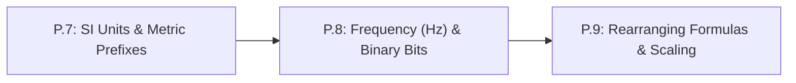

# Lesson P.8: Cycle Frequency (`Hz`), Period ($T = 1/f$) and Binary Bits ($2^N$)

<!-- run-callout:start -->
> **Step 1 of 10 · Python and the maths a robot needs**
>
> **Run this in the workbench.** [Open MechaLab with `P.8` loaded](https://tle47.github.io/Mechatronics-Roadmap/?lesson=P.8) - it opens on the **Run Python Lessons** tab with that entry selected. Starter code, hints and the graded check are ready; this page is the reading copy, and nothing you type here is saved.
<!-- run-callout:end -->

## Goal
Convert between a repeating signal's **frequency** ($f$, in Hertz `Hz`) and its **period** ($T = 1/f$, in seconds), and use **powers of 2** ($2^N$) to calculate the exact integer range of an $N$-bit microcontroller register.

- **New ideas (max 2):**
  1. **Cycle frequency (`Hz`) and period ($T = 1/f$)**: Relating how many cycles happen per second (`Hz`) to the time duration of a single cycle ($T = \frac{1}{f}$).
  2. **Binary bits and powers of 2 ($2^N$)**: Why $N$ digital bits (`0` or `1`) represent $2^N$ distinct integers from `0` to $2^N - 1$ (explaining `0..255` for 8-bit and `0..1023` for 10-bit).
- **New syntax:** `1.0 / freq_hz`, `(2 ** n_bits) - 1`.
- **Target time (unmeasured — [log yours](../.github/ISSUE_TEMPLATE/beginner-timing-log.md)):** Typical: 1.0–1.5 hours | Slow-learner: 2.0–3.0 hours

---

## Prerequisites
- [Lesson P.2: Computer Arithmetic and Order of Operations](P.2-arithmetic-and-order-of-operations.md)
- [Lesson P.7: Base SI Units & Metric Prefixes (`M`, `k`, `m`, `µ`)](P.7-si-units-and-metric-prefixes.md)



---

## Learn

<!-- figure: bit-weights | Eight bits, eight weights: the byte the lesson builds is the three bits it turns on. -->


### Idea 1: Cycle frequency (`Hz`) and period ($T = 1/f$)
- **Primary resource:** [The Physics Classroom — Frequency and Period of a Wave](https://www.physicsclassroom.com/class/waves/Lesson-2/Frequency-and-Period-of-a-Wave) `[HTTP 200 — Verified by scripts/check_links.py]`
  - **What to read:** Read exact heading **`Frequency and Period of a Wave`** (specifically the reciprocal formulas $f = 1/T$ and $T = 1/f$).
  - **What to skip:** Skip the bottom pendulum/mass-on-a-spring practice questions once $T = 1/f$ is clear.
  - **Key takeaway:** **Frequency** ($f$, measured in **Hertz `Hz`**, where $1\text{ Hz} = 1\text{ cycle per second}$) counts how many times a control loop or switching signal repeats each second. **Period** ($T$, measured in seconds `s`) is the time duration of *one* cycle. They are exact reciprocals: $T = \frac{1}{f}$ and $f = \frac{1}{T}$.

### Idea 2: Binary bits and powers of 2 ($2^N$)
- **Primary resource:** [SparkFun — Binary](https://learn.sparkfun.com/tutorials/binary) `[HTTP 200 — Verified by scripts/check_links.py]`
  - **What to read:** Read exact headings **`Why Binary?`**, **`Counting in binary`**, and **`Converting binary to decimal`**.
  - **What to skip:** Skip **`Bitwise Operators`**, **`Hexadecimal`**, and **`Two's Complement`** (not needed until Track 04).
  - **Key takeaway:** Digital circuits store numbers using **bits** (binary digits that are either `0` for OFF or `1` for ON). Each extra bit doubles the number of possible combinations, so an **$N$-bit** register has **$2^N$ states** numbered from **`0` up to $2^N - 1$**.
  - **Alternative resource:** [MathsIsFun — Binary Number System](https://www.mathsisfun.com/binary-number-system.html) `[HTTP 200 — Verified by scripts/check_links.py]` — Read exact headings **`How do we Count using Binary?`** and **`Position`** (powers of 2: $1, 2, 4, 8, 16, \dots$).

### Bridge Notes
Two sets of numbers appear in almost every microcontroller program you will ever write:

First, **frequency ($f$)** and **period ($T$)** are two ways of describing the same clock tick:

$$
T = \frac{1}{f}, \qquad f = \frac{1}{T}
$$

- A standard hobby pulse repeats at $f = 50\text{ Hz}$, so each cycle lasts $T = \frac{1}{50\text{ Hz}} = 0.020\text{ s} = 20\text{ ms}$.
- A fast robot control loop runs at $f = 1\text{ kHz}$ ($1{,}000\text{ Hz}$), so each time step is $T = \frac{1}{1000\text{ Hz}} = 0.001\text{ s} = 1.0\text{ ms}$.

Second, **binary bits ($2^N$)** explain why microcontrollers use seemingly strange maximum numbers like `255` and `1023` instead of `100` or `1000`:
- **8-bit register** (1 **byte**, used by 8-bit output commands): $2^8 = 256$ states $\rightarrow$ integers **`0` to `255`** ($2^8 - 1$).
- **10-bit register** (used by 10-bit sensor inputs): $2^{10} = 1{,}024$ states $\rightarrow$ integers **`0` to `1023`** ($2^{10} - 1$).
- **12-bit register** (used by 12-bit sensor inputs in later tracks): $2^{12} = 4{,}096$ states $\rightarrow$ integers **`0` to `4095`** ($2^{12} - 1$).

Because counting starts at `0`, the maximum integer is always **$2^N - 1$**.

---

## Do it yourself

- **What is simulated and in which tool:** Runs 100% in Python (zero-install in [futurecoder.io](https://futurecoder.io/course/) `[verify in-app]` or locally via `python3`).
- **What is real-hardware only:** Nothing in this lesson requires hardware.

### Starter Code (runs as-is — fill in the TODOs)
Complete `freq_to_period_ms` (`TODO 1`) and `max_unsigned_int` (`TODO 2`) to compute the period in milliseconds (`ms`) and the maximum integer value of 8-bit, 10-bit, and 12-bit registers:

```python
def freq_to_period_ms(freq_hz):
    # TODO 1: Compute period_s = 1.0 / freq_hz in seconds,
    #         then multiply by 1000.0 to return milliseconds (ms).
    return 0.0


def max_unsigned_int(n_bits):
    # TODO 2: Return (2 ** n_bits) - 1
    return 0


print(f"50 Hz period: {freq_to_period_ms(50.0):.2f} ms | 490 Hz period: {freq_to_period_ms(490.0):.3f} ms")
print(f"8-bit max: {max_unsigned_int(8)} | 10-bit max: {max_unsigned_int(10)} | 12-bit max: {max_unsigned_int(12)}")
```

### Expected Output
When `TODO 1` and `TODO 2` are completed, running the script prints:

```text
50 Hz period: 20.00 ms | 490 Hz period: 2.041 ms
8-bit max: 255 | 10-bit max: 1023 | 12-bit max: 4095
```

### Hint Ladder

<details>
<summary><strong>Hint 1 (Concept nudge)</strong></summary>

In `TODO 1`, `1.0 / freq_hz` gives seconds, and multiplying by `1000.0` converts seconds to milliseconds (`ms`). In `TODO 2`, use `**` for powers of 2: `(2 ** n_bits) - 1`.
</details>

<details>
<summary><strong>Hint 2 (Formula / structure)</strong></summary>

```python
def freq_to_period_ms(freq_hz):
    return (1.0 / freq_hz) * 1000.0

def max_unsigned_int(n_bits):
    return (2 ** n_bits) - 1
```
</details>

<details>
<summary><strong>Full Solution</strong></summary>

```python
def freq_to_period_ms(freq_hz):
    return (1.0 / freq_hz) * 1000.0


def max_unsigned_int(n_bits):
    return (2 ** n_bits) - 1


assert round(freq_to_period_ms(50.0), 2) == 20.00
assert round(freq_to_period_ms(490.0), 3) == 2.041
assert max_unsigned_int(8) == 255
assert max_unsigned_int(10) == 1023
assert max_unsigned_int(12) == 4095

print(f"50 Hz period: {freq_to_period_ms(50.0):.2f} ms | 490 Hz period: {freq_to_period_ms(490.0):.3f} ms")
print(f"8-bit max: {max_unsigned_int(8)} | 10-bit max: {max_unsigned_int(10)} | 12-bit max: {max_unsigned_int(12)}")
```
</details>

---

## Common mistakes & troubleshooting
- **Saying an 8-bit register goes up to `256` instead of `255`:** There are $2^8 = 256$ total values, but because `0` uses the first slot, the highest number is $256 - 1 = \mathbf{255}$.
- **Forgetting to convert `kHz` to `Hz` before taking $1/f$:** For a $20\text{ kHz}$ switching wave, convert $20\text{ kHz} = 20{,}000\text{ Hz}$ first so $T = \frac{1}{20{,}000} = 0.00005\text{ s} = 50\ \mu\text{s}$.

---

## Check yourself

1. **Period to frequency:** A control loop executes once every $T = 0.5\text{ ms}$ ($0.0005\text{ s}$). What is its frequency $f$ in `Hz` and in `kHz`?
   <details>
   <summary><strong>Answer</strong></summary>

   $f = \frac{1}{0.0005\text{ s}} = \mathbf{2{,}000\text{ Hz}} = \mathbf{2.0\text{ kHz}}$.
   </details>

2. **Why `1023`?** In one sentence, explain why a 10-bit sensor register returns a maximum of `1023` instead of `1000`.
   <details>
   <summary><strong>Answer</strong></summary>

   Because a 10-bit binary register has $2^{10} = 1{,}024$ possible states, and starting the count at `0` makes the highest state $1024 - 1 = \mathbf{1023}$.
   </details>

3. **4-bit range:** How many total states does a 4-bit binary number have, and what is its maximum integer value?
   <details>
   <summary><strong>Answer</strong></summary>

   $2^4 = \mathbf{16\text{ states}}$, ranging from `0` to $2^4 - 1 = \mathbf{15}$.
   </details>

---

## Recap
- **Frequency ($f$, in `Hz`)** and **period ($T$, in `s`)** are reciprocals: $T = \frac{1}{f}$ and $f = \frac{1}{T}$.
- An **$N$-bit** binary register stores $2^N$ integers from **`0` to $2^N - 1$** (`0..255` for 8-bit, `0..1023` for 10-bit).

### You're ready to move on when...
- [ ] You can convert between `Hz` and `ms`/`µs` using $T = 1/f$.
- [ ] You know why 8-bit is `0..255` and 10-bit is `0..1023`.
- [ ] Your **Do it yourself** script passes all assertions.

<!-- next-step:start -->
👉 **Next:** [Step 1 · Python and the maths a robot needs — Lesson P.9: Rearranging Physics Formulas and Linear Range Scaling](P.9-rearranging-formulas-and-scaling.md)
<!-- next-step:end -->
