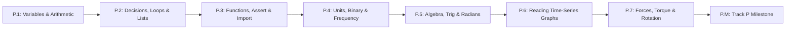

# Track P: Prerequisites (Zero-Background Entry Ramp)

Welcome to **Track P**! If you have never written a line of code, never wired a circuit, and only remember basic school arithmetic, **start right here**. Track P teaches *only* the exact Python, units, algebra, trigonometry, graph-reading, and mechanics concepts actually used in Stage 0 and Pass 1—maximum 2 new ideas per lesson, zero hardware required.

## Lesson List & Time Estimates (Untimed Guesses)

| Lesson | Title | New Ideas (Max 2) | Typical Time | Slow-Learner Time |
| :--- | :--- | :--- | :--- | :--- |
| **[P.1](P.1-variables-types-and-arithmetic.md)** | **Variables, Data Types & Arithmetic Expressions** | 1. Variables & types (`int`, `float`, `str`, `bool`) 2. Computer arithmetic & order of operations `()` | 2.0–2.5 hrs | 3.5–4.5 hrs |
| **[P.2](P.2-decisions-loops-and-lists.md)** | **Decisions (`if/else`), `for` Loops & Lists** | 1. Conditional branching (`if/elif/else`) 2. Zero-indexed `list` & `for` loops | 2.5–3.5 hrs | 4.5–6.0 hrs |
| **[P.3](P.3-functions-assert-and-import.md)** | **Reusable Functions (`def`/`return`), Self-Tests (`assert`) & `import`** | 1. Functions (`def`/`return`) & `while` loops 2. Automated checks (`assert`) & `import math` | 2.0–3.0 hrs | 4.0–5.0 hrs |
| **[P.4](P.4-units-prefixes-binary-and-frequency.md)** | **SI Units, Metric Prefixes, Binary Bits & Frequency (`Hz`)** | 1. SI units, prefixes (`m`, `µ`, `k`, `M`) & $f = 1/T$ 2. Binary bits (`0`/`1`) & powers of 2 ($2^N$) | 1.5–2.0 hrs | 2.5–3.5 hrs |
| **[P.5](P.5-algebra-and-trigonometry-for-robotics.md)** | **Rearranging Formulas, Right-Triangle Trig & Radians** | 1. Rearranging equations & linear scaling 2. Right-triangle trig (`sin`, `cos`, `atan2`) & radians | 2.0–2.5 hrs | 3.5–4.5 hrs |
| **[P.6](P.6-reading-time-series-graphs.md)** | **Reading Time-Series Graphs — Slope & Area** | 1. Graph slope as rate of change ($\Delta y / \Delta t$) 2. Area under curve as accumulation ($v \cdot \Delta t$) | 1.5–2.0 hrs | 2.5–3.5 hrs |
| **[P.7](P.7-forces-torque-and-rotational-motion.md)** | **Forces ($F = ma$), Lever Torque ($\tau = rF\sin\theta$) & Rotational Speed** | 1. Force, weight ($W = mg$) & $F_{\text{net}} = ma$ 2. Torque ($\tau = rF\sin\theta$) & `RPM` $\to$ `rad/s` | 1.5–2.0 hrs | 2.5–3.5 hrs |
| **[P.M](P.M-track-p-milestone.md)** | **Track P Milestone — Gravity-Holding Robot Arm Link Simulator** | 1. End-to-end sense-compute-simulate loop | 1.0–1.5 hrs | 2.0–2.5 hrs |
| **Total** | **8 Lessons** | **Zero-install browser Python (`futurecoder.io`)** | **14.0–19.0 hrs** | **25.0–33.0 hrs** |

- **Next Stage:** [Stage 0: Electronics & Microcontroller Foundations (`stage-0/README.md`)](../stage-0/README.md)
