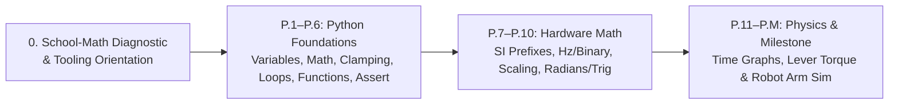

# Track P: Prerequisites (Zero-Background Entry Ramp)

Welcome to **Track P**! If you have never written a line of code, never wired a circuit, and only remember basic school arithmetic, **start right here**. Track P teaches *only* the exact Python, units, binary numbers, algebra, trigonometry, time-series graph reading, and lever torque ($\tau = mgL\cos\theta$) used in this roadmap—with **at most 2 new ideas per lesson** and zero software installation required.

---

## 1. Computer-Tooling Orientation (Zero-Jargon Quickstart)

Before writing your first line of Python, here is how your workspace operates so you never confuse a tool question with a robotics question:
1. **Where to run code (\$0 Zero-Install):** Open **[Tab 2: Run Python Lessons](https://tle47.github.io/Mechatronics-Roadmap/)** in the live Browser Workbench. Select any lesson (`P.1` through `08.1`) on the left, edit the `# TODO` lines in the center editor, and click **Run & Verify Output**.
2. **How to recover from mistakes or infinite loops:**
   - **Stop (`OctagonX` button):** If you accidentally write an infinite loop (such as `while True:`), Python runs inside an isolated background **Web Worker**. Click **Stop** (or wait ~4 seconds for the automatic step limit) to cancel execution without losing a single character of your editor code.
   - **Reset Runtime:** Restarts a fresh Python interpreter in the background while keeping your current editor code intact.
   - **Reset Starter:** Restores the lesson's original `# TODO` starter template if you want to start the exercise over.
3. **How your work and progress are saved:** Every lesson that passes both **Instructor Behavioral Tests** (multi-input & boundary checks) and **Output Presentation** is automatically saved in your browser's `localStorage` as **Executed & Passed (WASM)**. Click **Export Portfolio (`.md`)** in the top bar at any time to download a portable Markdown backup of your progress.
4. **How to read the three types of error messages:**
   - `SyntaxError (line N)`: Python could not parse the grammar on line `N` (check for a missing parenthesis `)`, colon `:`, or quotation mark `"`).
   - `AssertionError` / `BEHAVIOR FAILED`: Your code ran, but one of the engineering checks failed on a boundary or test input—read the red diagnostic line under **Instructor Behavioral Assessment** or unlock the next step in the **3-Step Hint Ladder**.
   - `ExecutionTimeoutError`: A `while` loop never reached its stopping condition (for example, forgetting `step = step + 1` inside a loop).

---

## 2. Explicit School-Math Diagnostic & Just-In-Time Refresher Routes

You do **not** need to take a separate math course before starting robotics. Use this 6-topic self-check (also available interactively in **Tab 3: Placement & Readiness $\to$ School-Math Diagnostic** of the Workbench) to choose **"I know this"**, **"Show me a refresher"**, or **"Teach it from scratch"** right when a lesson needs it:

| School-Math Skill | Quick Self-Check Question | Route A: "I know this" | Route B: "Show me a 2-minute refresher" | Route C: "Teach it from scratch" |
| :--- | :--- | :--- | :--- | :--- |
| **1. Negative Numbers, Fractions, Percentages & Ratios** | What is $-15 + 40$, and what is $\frac{10}{10 + 20}$ as a decimal and percentage? | Proceed to [`P.1`](P.1-variables-and-data-types.md)–[`P.3`](P.3-decisions-and-clamping.md) | $-15 + 40 = +25$. A ratio $\frac{\text{part}}{\text{whole}} = \frac{10}{30} \approx 0.3333$ ($33.3\%$). Multiply a fraction by $100$ to get `%`. | **[Lesson P.2](P.2-arithmetic-and-order-of-operations.md)** & **[Lesson P.3](P.3-decisions-and-clamping.md)** |
| **2. Powers, Square Roots & Scientific Notation** | What is $2^{10}$, $\sqrt{3^2 + 4^2}$, and $1.5 \times 10^{-3}$ in decimal? | Proceed to [`P.6`](P.6-modules-and-automated-asserts.md) & [`P.8`](P.8-frequency-and-binary-bits.md) | $2^{10} = 1024$; $\sqrt{9+16} = \sqrt{25} = 5.0$; $10^{-3}$ shifts the decimal 3 places left $\to 0.0015$. | **[Lesson P.6](P.6-modules-and-automated-asserts.md)** & **[Lesson P.8](P.8-frequency-and-binary-bits.md)** |
| **3. Unit Conversion & Metric Prefixes (`M`, `k`, `m`, `µ`)** | Convert $15\text{ mA}$ to Amps (`A`) and $500\ \mu\text{s}$ to seconds (`s`). | Skip [`P.7`](P.7-si-units-and-metric-prefixes.md) if you pass its assert check | `k` $= \times 10^3$, `M` $= \times 10^6$, `m` (milli) $= \div 1000$, `µ` (micro) $= \div 1{,}000{,}000$. So $15\text{ mA} = 0.015\text{ A}$ and $500\ \mu\text{s} = 0.0005\text{ s}$. | **[Lesson P.7](P.7-si-units-and-metric-prefixes.md)** |
| **4. Rearranging a Simple Formula** | If $\Delta x = v \cdot \Delta t$, solve for speed $v$ when $\Delta x = 3.0\text{ m}$ and $\Delta t = 0.015\text{ s}$. | Skip [`P.9`](P.9-rearranging-formulas-and-scaling.md) if you pass its assert check | Divide both sides by $\Delta t$: $v = \frac{\Delta x}{\Delta t} = \frac{3.0}{0.015} = 200.0\text{ m/s}$. | **[Lesson P.9](P.9-rearranging-formulas-and-scaling.md)** |
| **5. Reading a Graph & Estimating Slope or Area** | If position rises from $1.2\text{ m}$ to $2.2\text{ m}$ over $0.5\text{ s}$, what is the slope (velocity)? | Skip [`P.11`](P.11-reading-time-series-graphs.md) if you pass its assert check | $\text{Slope} = \frac{\text{rise}}{\text{run}} = \frac{2.2 - 1.2}{0.5} = 2.0\text{ m/s}$. Rectangle area $= \text{height} \times \text{width} = v \cdot \Delta t$ (distance moved). | **[Lesson P.11](P.11-reading-time-series-graphs.md)** |
| **6. Radians & Basic Sine / Cosine** | How many radians is $180^\circ$, and what are $(\cos 0^\circ, \sin 0^\circ)$ vs. $(\cos 90^\circ, \sin 90^\circ)$? | Skip [`P.10`](P.10-radians-and-right-triangle-trig.md) if you pass its assert check | $180^\circ = \pi\text{ rad} \approx 3.1416\text{ rad}$. $\cos\theta$ is horizontal reach ($1$ at $0^\circ$, $0$ at $90^\circ$); $\sin\theta$ is vertical height ($0$ at $0^\circ$, $1$ at $90^\circ$). | **[Lesson P.10](P.10-radians-and-right-triangle-trig.md)** & **[Lesson P.12](P.12-forces-and-lever-torque.md)** |

---

## 3. Lesson Map & Unmeasured Target Times

> **Note on Timing:** Per-lesson times below (`~45–90 min` target per lesson, `~10–13 hours` total for Track P) are **unmeasured author targets**, not empirical averages. If you are a beginner working through Track P, please submit your actual per-lesson completion times using our **[Beginner Timing Log Issue Template](../.github/ISSUE_TEMPLATE/beginner-timing-log.md)**!

| Lesson | Title | New Ideas (Max 2, Enforced in YAML Front Matter) | Unmeasured Target | Unmeasured Slow-Paced Target |
| :--- | :--- | :--- | :--- | :--- |
| **[Lesson P.1](P.1-variables-and-data-types.md)** | **Variables & Fundamental Data Types** | 1. Storing values in named variables 2. Fundamental data types (`int`, `float`, `str`, `bool`) | ~45–60 min (unmeasured) | ~90–120 min (unmeasured) |
| **[Lesson P.2](P.2-arithmetic-and-order-of-operations.md)** | **Computer Arithmetic & Order of Operations** | 1. Computer arithmetic operators 2. Parentheses and order of operations | ~45–60 min (unmeasured) | ~90–120 min (unmeasured) |
| **[Lesson P.3](P.3-decisions-and-clamping.md)** | **Conditional Decisions (`if/elif/else`) & Command Clamping** | 1. Conditional branching (`if/elif/else`) 2. Clamping actuator commands within safe limits | ~60–90 min (unmeasured) | ~120–150 min (unmeasured) |
| **[Lesson P.4](P.4-lists-and-for-loops.md)** | **Ordered Lists & Repeating Actions with `for` Loops** | 1. Ordered lists with zero-based indexing 2. Repeating actions with `for` loops | ~60–90 min (unmeasured) | ~120–150 min (unmeasured) |
| **[Lesson P.5](P.5-functions-and-while-loops.md)** | **Reusable Functions (`def`/`return`) & `while` Loops** | 1. Reusable functions (`def` and `return`) 2. Condition-controlled `while` loops | ~60–90 min (unmeasured) | ~120–150 min (unmeasured) |
| **[Lesson P.6](P.6-modules-and-automated-asserts.md)** | **Loading Modules (`import`) & Automated Self-Checks (`assert`)** | 1. Loading standard-library modules with `import` 2. Automated self-checks with `assert` | ~45–60 min (unmeasured) | ~90–120 min (unmeasured) |
| **[Lesson P.7](P.7-si-units-and-metric-prefixes.md)** | **Base SI Units & Metric Prefixes (`M`, `k`, `m`, `µ`)** | 1. Base SI units for mechatronics 2. Metric prefixes (`M`, `k`, `m`, `µ`) | ~45–60 min (unmeasured) | ~90–120 min (unmeasured) |
| **[Lesson P.8](P.8-frequency-and-binary-bits.md)** | **Cycle Frequency (`Hz`), Period ($T=1/f$) & Binary Bits ($2^N$)** | 1. Cycle frequency (`Hz`) and period ($T = 1/f$) 2. Binary bits and powers of 2 ($2^N$) | ~45–60 min (unmeasured) | ~90–120 min (unmeasured) |
| **[Lesson P.9](P.9-rearranging-formulas-and-scaling.md)** | **Rearranging Physics Formulas & Linear Range Scaling** | 1. Rearranging three-variable physics formulas 2. Linear range scaling | ~45–60 min (unmeasured) | ~90–120 min (unmeasured) |
| **[Lesson P.10](P.10-radians-and-right-triangle-trig.md)** | **Radians, Rotational Speed (`rad/s`) & Right-Triangle Trig** | 1. Measuring angles in radians and rotational speed (`rad/s`) 2. Right-triangle trigonometry (`cos`, `sin`, `atan2`) | ~60–90 min (unmeasured) | ~120–150 min (unmeasured) |
| **[Lesson P.11](P.11-reading-time-series-graphs.md)** | **Reading Time-Series Graphs — Slope & Area** | 1. Graph slope as rate of change 2. Area under a curve as accumulated change | ~60–90 min (unmeasured) | ~120–150 min (unmeasured) |
| **[Lesson P.12](P.12-forces-and-lever-torque.md)** | **Linear Forces ($F = ma$) & Lever Torque ($\tau = mgL\cos\theta$)** | 1. Linear force ($F = ma$) and gravitational weight ($W = mg$) 2. Lever torque from horizontal arm angle ($\tau = mgL\cos\theta$) | ~60–90 min (unmeasured) | ~120–150 min (unmeasured) |
| **[Lesson P.M](P.M-track-p-milestone.md)** | **Track P Milestone — Gravity-Holding Robot Arm Simulator** | 1. End-to-end sense-compute-simulate loop | ~45–60 min (unmeasured) | ~90–120 min (unmeasured) |
| **Total Track P** | **12 Lessons + 1 Milestone (13 Files)** | **25 Ideas Total ($\le 2$ per lesson)** | **Unmeasured (~10–13 hrs total target)** | **Submit logs via Issue Template** |

---

## 4. How to Run the Exercises (Zero Installation Required)
1. **In your browser (Web-Worker Isolated Pyodide Runner):** Open **Tab 2 (`Run Python Lessons`)** in the live MechaLab Workbench to edit starter code, unlock 3-step progressive hints, and run instructor behavioral tests directly in your browser.
2. **Or locally:** Run `python3 tests/test_exercises.py` to execute all automated exercise and behavioral tests across the roadmap.

👉 **Start now:** [Lesson P.1: Variables and Fundamental Data Types (`int`, `float`, `str`, `bool`)](P.1-variables-and-data-types.md)
