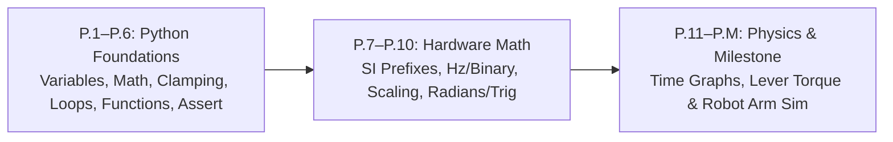

# Track P: Prerequisites (Zero-Background Entry Ramp)

Welcome to **Track P**! If you have never written a line of code, never wired a circuit, and only remember basic school arithmetic, **start right here**. Track P teaches *only* the exact Python, units, binary numbers, algebra, trigonometry, time-series graph reading, and lever torque ($\tau = mgL\cos\theta$) used in this roadmap—with **at most 2 new ideas per lesson** and zero software installation required.

---

## Lesson Map & Unmeasured Target Times

> **Note on Timing:** Per-lesson times below (`~45–90 min` target per lesson) are **unmeasured author targets**, not empirical averages. If you are a beginner working through Track P, please submit your actual per-lesson completion times using our **[Beginner Timing Log Issue Template](../.github/ISSUE_TEMPLATE/beginner-timing-log.md)**!

| Lesson | Title | New Ideas (Max 2, Enforced in YAML Front Matter) | Unmeasured Target | Unmeasured Slow-Paced Target |
| :--- | :--- | :--- | :--- | :--- |
| **[Lesson P.1](P.1-variables-and-data-types.md)** | **Variables & Fundamental Data Types** | 1. Storing values in named variables 2. Fundamental data types (`int`, `float`, `str`, `bool`) | ~45–60 min (unmeasured) | ~90–120 min (unmeasured) |
| **[Lesson P.2](P.2-arithmetic-and-order-of-operations.md)** | **Computer Arithmetic & Order of Operations** | 1. Computer arithmetic operators 2. Parentheses and order of operations | ~45–60 min (unmeasured) | ~90–120 min (unmeasured) |
| **[Lesson P.3](P.3-decisions-and-clamping.md)** | **Conditional Decisions (`if/elif/else`) & Command Clamping** | 1. Conditional branching (`if/elif/else`) 2. Clamping actuator commands within safe limits | ~60–90 min (unmeasured) | ~120–150 min (unmeasured) |
| **[Lesson P.4](P.4-lists-and-for-loops.md)** | **Ordered Lists & Repeating Actions with `for` Loops** | 1. Ordered lists with zero-based indexing 2. Repeating actions with `for` loops | ~60–90 min (unmeasured) | ~120–150 min (unmeasured) |
| **[Lesson P.5](P.5-functions-and-while-loops.md)** | **Reusable Functions (`def`/`return`) & `while` Loops** | 1. Reusable functions (`def` and `return`) 2. Condition-controlled `while` loops | ~60–90 min (unmeasured) | ~120–150 min (unmeasured) |
| **[Lesson P.6](P.6-modules-and-automated-asserts.md)** | **Loading Modules (`import`) & Automated Self-Checks (`assert`)** | 1. Loading standard-library modules with `import` 2. Automated self-checks with `assert` | ~45–60 min (unmeasured) | ~90–120 min (unmeasured) |
| **[Lesson P.7](P.7-si-units-and-metric-prefixes.md)** | **Base SI Units & Metric Prefixes (`M`, `k`, `m`, `µ`)** | 1. Base SI units for mechatronics 2. Metric prefixes (`M`, `k`, `m`, `µ`) | ~45–60 min (unmeasured) | ~90–120 min (unmeasured) |
| **[Lesson P.8](P.8-frequency-and-binary-bits.md)** | **Cycle Frequency (`Hz`), Period ($T=1/f$) & Binary Bits ($2^N$)** | 1. Cycle frequency (`Hz`) and period ($T = 1/f$) 2. Binary bits and powers of 2 ($2^N$) | ~45–60 min (unmeasured) | ~90–120 min (unmeasured) |
| **[Lesson P.9](P.9-rearranging-formulas-and-scaling.md)** | **Rearranging Physics Formulas & Linear Range Scaling** | 1. Rearranging three-variable physics formulas 2. Linear range scaling | ~45–60 min (unmeasured) | ~90–120 min (unmeasured) |
| **[Lesson P.10](P.10-radians-and-right-triangle-trig.md)** | **Radians, Rotational Speed (`rad/s`) & Right-Triangle Trig** | 1. Measuring angles in radians and rotational speed (`rad/s`) 2. Right-triangle trigonometry (`cos`, `sin`, `atan2`) | ~60–90 min (unmeasured) | ~120–150 min (unmeasured) |
| **[Lesson P.11](P.11-reading-time-series-graphs.md)** | **Reading Time-Series Graphs — Slope & Area** | 1. Graph slope as rate of change 2. Area under a curve as accumulated change | ~60–90 min (unmeasured) | ~120–150 min (unmeasured) |
| **[Lesson P.12](P.12-forces-and-lever-torque.md)** | **Linear Forces ($F = ma$) & Lever Torque ($\tau = mgL\cos\theta$)** | 1. Linear force ($F = ma$) and gravitational weight ($W = mg$) 2. Lever torque from horizontal arm angle ($\tau = mgL\cos\theta$) | ~60–90 min (unmeasured) | ~120–150 min (unmeasured) |
| **[Lesson P.M](P.M-track-p-milestone.md)** | **Track P Milestone — Gravity-Holding Robot Arm Simulator** | 1. End-to-end sense-compute-simulate loop | ~45–60 min (unmeasured) | ~90–120 min (unmeasured) |
| **Total Track P** | **12 Lessons + 1 Milestone (13 Files)** | **25 Ideas Total ($\le 2$ per lesson)** | **Unmeasured (~45–90 min/lesson target)** | **Submit logs via Issue Template** |

---

## How to Run the Exercises (Zero Installation Required)
1. **In your browser (Embedded Pyodide Runner):** Open **Tab 9 (`In-Browser Python Runner`)** in the live MechaLab Workbench to edit starter code, unlock 3-step progressive hints, and run `assert` checks directly in your browser.
2. **Or locally:** Run `python3 tests/test_exercises.py` to execute all automated exercise and math tests across the roadmap.

👉 **Start now:** [Lesson P.1: Variables and Fundamental Data Types (`int`, `float`, `str`, `bool`)](P.1-variables-and-data-types.md)
